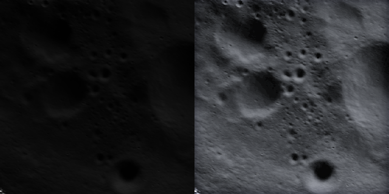

# IllumiCurveNet benchmark reproduction report

| Item | Details |
| --- | --- |
| Paper | *IllumiCurveNet: Low-Light Image Enhancement of Lunar Permanently Shadowed Regions Using a Self-Guided Loss Framework* |
| Authors | Saksham Jain, Sparsh Jain, Ashish Prajapati, Garvit Singh, and Dinesh Kumar Vishwakarma |
| Publication | IJCNN 2025, DOI 10.1109/IJCNN64981.2025.11227405. [Published paper](https://doi.org/10.1109/IJCNN64981.2025.11227405) |
| Objective | Reproduce the raw-input and pretrained IllumiCurveNet scores in Table II on the published 40-image lunar benchmark. |
| Outcome | All three raw averages matched at the reported precision. Enhanced averages differed by 0.01–0.16 points across the three metrics. |
| Scope | Pretrained inference, dataset verification, and quantitative scoring. Training, competing models, and ablations remain unverified locally. |

## Architecture and experimental setup

| Item | Details |
| --- | --- |
| Model | Encoder–decoder with learnable enhancement curves, spatial attention, dilated convolutions, max pooling and unpooling, and adaptive gamma correction. [Architecture diagram](illumi-curve-net-main/diagrams/model-architecture.png) |
| Training objective | Self-guided loss combining exposure control, spatial consistency, color consistency, total variation, texture preservation, and contrast enhancement. |
| Training settings reported in Section IV-A | 50 epochs, batch size 64, learning rate 0.0001, weight decay 0.0001, gradient clipping at 0.1, Gaussian convolution initialization with mean 0 and standard deviation 0.02. |
| Local model and checkpoint | Authors’ implementation and weights. [Model source](illumi-curve-net-main/model.py) · [Checkpoint](illumi-curve-net-main/snapshots/model-best.pth) |
| Runtime | PyTorch 2.11.0 with CUDA 13.0, GPU inference, and PyIQA 0.1.13 on CPU for scoring. |
| Preprocessing | Read each 400 × 400 RGB TIFF, divide its pixel values by 255, convert to float32 in channel-first format, and pass it through the network without resizing. |
| Evaluation | Convert enhanced tensors to uint8 by multiplying by 255 and truncating, as in the [metrics notebook](illumi-curve-net-main/metrics.ipynb). Compute each metric on the raw and enhanced images and take the arithmetic mean over all 40 images. |

| No-reference metric | What it measures |
| --- | --- |
| PIQE | Perception-based Image Quality Evaluator. Estimates perceptual distortion from local image blocks. |
| NIQE | Natural Image Quality Evaluator. Measures deviation from a statistical model of natural images. |
| BRISQUE | Blind/Referenceless Image Spatial Quality Evaluator. Uses spatial image statistics to estimate distortion. |

Lower scores are better for all three metrics. These scores characterize image quality without a ground-truth reference. Verification of lunar terrain detail is outside the scope of this evaluation.

## Pretrained GPU inference

The authors’ `test.py` completed successfully with the bundled `snapshots/model-best.pth` checkpoint. The input was the raw lunar image embedded in Figure 1 of the [paper](https://doi.org/10.1109/IJCNN64981.2025.11227405). The run used PyTorch 2.11.0 and TorchVision 0.26.0 with CUDA 13.0.

| Measurement | Raw input | Enhanced output |
| --- | ---: | ---: |
| Image dimensions | 400 × 400 | 400 × 400 |
| Mean grayscale intensity (0–255) | 10.23 | 68.96 |

[Raw input](illumi-curve-net-main/data/test_data/paper-figure-1/raw.png) · [Enhanced output](illumi-curve-net-main/data/result/paper-figure-1/raw.png)

## Dataset verification

| Dataset | Contents | Verification and source |
| --- | --- | --- |
| Training | 2,002 RGB JPEGs at 512 × 512. Section IV-A identifies SICE Part 1 as their source. | All files passed Pillow verification. [Kaggle archive](https://www.kaggle.com/datasets/ashishprajapati1306/illumicurvenet-training-data) |
| Lunar benchmark | 40 RGB TIFFs at 400 × 400, with 20 images per lunar pole. | `comtestSN.zip` passed its integrity check and all 40 images were scored. [ZSPL-PSR author’s data repository](https://github.com/dl-zfq/PSR_Enhancement/tree/HEAD/test_set) |

## Lunar benchmark

| Metric (lower is better) | Raw local | Raw reported | Enhanced local | Enhanced reported | Enhanced difference |
| --- | ---: | ---: | ---: | ---: | ---: |
| PIQE | 54.06 | 54.06 | 36.56 | 36.40 | +0.16 |
| NIQE | 12.07 | 12.07 | 8.37 | 8.38 | −0.01 |
| BRISQUE | 56.87 | 56.87 | 36.64 | 36.55 | +0.09 |

All three raw means match the [reported values](illumi-curve-net-main/README.md) to two decimal places. The enhanced means were close to the reported results, with absolute differences of 0.01–0.16. The cause of these differences was undetermined.

The run used the bundled checkpoint for GPU inference and followed the [metrics notebook](illumi-curve-net-main/metrics.ipynb) for 8-bit conversion before scoring. PyIQA 0.1.13 ran on CPU because its CUDA path could not load the NVRTC builtins library. The run restored the original BRISQUE support-vector layout before each scoring call to account for PyIQA’s in-place transpose. Training has yet to run.

[Per-image scores for all 40 inputs and outputs](illumi-curve-net-main/data/result/PSR/scores.csv) · [Enhanced images](illumi-curve-net-main/data/result/PSR)

## Quantitative comparison from the paper

The paper values below are from [Table II](https://doi.org/10.1109/IJCNN64981.2025.11227405).

| Method | PIQE ↓ | NIQE ↓ | BRISQUE ↓ | Local verification |
| --- | ---: | ---: | ---: | --- |
| Raw input | 54.06 | 12.07 | 56.87 | Matched at reported precision |
| Zero-DCE | 51.11 | 9.67 | 45.58 | Paper only |
| Zero-DCE++ | 51.59 | 9.75 | 46.42 | Paper only |
| ZSPL-PSR | 47.51 | 9.29 | 54.91 | Paper only |
| RRDNet | 52.55 | 10.01 | 43.16 | Paper only |
| RetinexDIP | 52.61 | 9.80 | 43.11 | Paper only |
| IllumiCurveNet, paper | 36.40 | 8.38 | 36.55 | Compared with local run |
| **IllumiCurveNet, local** | **36.56** | **8.37** | **36.64** | All 40 images scored |

## Ablations reported in the paper

These experiments are from [Table I](https://doi.org/10.1109/IJCNN64981.2025.11227405). Local testing used the full model.

| Model variant | PIQE ↓ | NIQE ↓ | BRISQUE ↓ |
| --- | ---: | ---: | ---: |
| Without spatial attention | 45.28 | 8.93 | 37.75 |
| Without gamma correction | 45.58 | 8.99 | 40.55 |
| Without max pooling and unpooling | 51.16 | 9.69 | 47.02 |
| Without texture loss | 47.18 | 9.02 | 47.06 |
| Without contrast loss | 42.99 | 8.67 | 37.01 |
| Without dilated convolutions | 42.15 | 8.58 | 37.50 |
| Full IllumiCurveNet | 36.40 | 8.38 | 36.55 |

## Per-image benchmark summary

| Metric | Mean reduction from raw | Images with improved score |
| --- | ---: | ---: |
| PIQE | 17.50 | 37/40 |
| NIQE | 3.69 | 40/40 |
| BRISQUE | 20.23 | 36/40 |

## Appendix. Scores for all 40 images

| Image | Raw PIQE | Enhanced PIQE | Raw NIQE | Enhanced NIQE | Raw BRISQUE | Enhanced BRISQUE |
| --- | ---: | ---: | ---: | ---: | ---: | ---: |
| [1.TIF](illumi-curve-net-main/data/result/PSR/1.png) | 36.12 | 20.15 | 10.26 | 6.61 | 55.39 | 44.04 |
| [2.TIF](illumi-curve-net-main/data/result/PSR/2.png) | 23.54 | 15.04 | 7.17 | 5.36 | 48.12 | 21.88 |
| [3.TIF](illumi-curve-net-main/data/result/PSR/3.png) | 61.72 | 38.59 | 12.93 | 7.19 | 65.84 | 44.07 |
| [4.TIF](illumi-curve-net-main/data/result/PSR/4.png) | 75.16 | 53.45 | 14.78 | 8.07 | 81.28 | 49.06 |
| [5.TIF](illumi-curve-net-main/data/result/PSR/5.png) | 60.23 | 37.28 | 12.40 | 7.13 | 68.54 | 53.01 |
| [6.TIF](illumi-curve-net-main/data/result/PSR/6.png) | 55.81 | 49.89 | 11.05 | 8.91 | 56.66 | 60.39 |
| [7.TIF](illumi-curve-net-main/data/result/PSR/7.png) | 49.09 | 32.46 | 11.96 | 7.34 | 62.58 | 41.81 |
| [8.TIF](illumi-curve-net-main/data/result/PSR/8.png) | 14.13 | 12.62 | 6.61 | 5.85 | 43.02 | 29.94 |
| [9.TIF](illumi-curve-net-main/data/result/PSR/9.png) | 65.20 | 46.93 | 16.29 | 10.55 | 65.22 | 40.60 |
| [10.TIF](illumi-curve-net-main/data/result/PSR/10.png) | 54.79 | 40.69 | 10.18 | 7.91 | 48.88 | 38.11 |
| [11.TIF](illumi-curve-net-main/data/result/PSR/11.png) | 34.44 | 39.06 | 8.46 | 7.32 | 19.52 | 51.91 |
| [12.TIF](illumi-curve-net-main/data/result/PSR/12.png) | 53.80 | 50.05 | 9.29 | 8.76 | 39.42 | 56.80 |
| [13.TIF](illumi-curve-net-main/data/result/PSR/13.png) | 64.77 | 47.09 | 12.93 | 7.83 | 64.69 | 29.79 |
| [14.TIF](illumi-curve-net-main/data/result/PSR/14.png) | 44.14 | 16.29 | 8.50 | 6.71 | 34.51 | 37.67 |
| [15.TIF](illumi-curve-net-main/data/result/PSR/15.png) | 52.58 | 26.39 | 10.52 | 6.26 | 62.23 | 38.73 |
| [16.TIF](illumi-curve-net-main/data/result/PSR/16.png) | 73.61 | 57.86 | 19.69 | 12.14 | 72.17 | 32.92 |
| [17.TIF](illumi-curve-net-main/data/result/PSR/17.png) | 61.82 | 33.11 | 13.29 | 8.19 | 63.27 | 21.65 |
| [18.TIF](illumi-curve-net-main/data/result/PSR/18.png) | 81.66 | 42.68 | 16.87 | 7.16 | 83.86 | 34.06 |
| [19.TIF](illumi-curve-net-main/data/result/PSR/19.png) | 48.96 | 47.26 | 9.05 | 8.93 | 50.07 | 49.35 |
| [20.TIF](illumi-curve-net-main/data/result/PSR/20.png) | 22.17 | 17.36 | 7.93 | 6.93 | 44.08 | 39.98 |
| [N1.TIF](illumi-curve-net-main/data/result/PSR/N1.png) | 42.58 | 34.55 | 10.84 | 8.26 | 48.24 | 17.99 |
| [N2.TIF](illumi-curve-net-main/data/result/PSR/N2.png) | 50.79 | 51.74 | 9.80 | 8.43 | 38.31 | 27.06 |
| [N3.TIF](illumi-curve-net-main/data/result/PSR/N3.png) | 55.66 | 36.56 | 10.25 | 8.07 | 56.42 | 21.79 |
| [N4.TIF](illumi-curve-net-main/data/result/PSR/N4.png) | 80.94 | 38.27 | 10.84 | 7.74 | 69.12 | 42.75 |
| [N5.TIF](illumi-curve-net-main/data/result/PSR/N5.png) | 70.62 | 36.29 | 15.52 | 9.77 | 68.69 | 39.74 |
| [N6.TIF](illumi-curve-net-main/data/result/PSR/N6.png) | 80.01 | 41.02 | 18.21 | 11.67 | 76.47 | 38.85 |
| [N7.TIF](illumi-curve-net-main/data/result/PSR/N7.png) | 62.35 | 40.98 | 8.46 | 6.48 | 65.39 | 33.73 |
| [N8.TIF](illumi-curve-net-main/data/result/PSR/N8.png) | 51.92 | 54.17 | 9.60 | 6.71 | 42.76 | 22.35 |
| [N9.TIF](illumi-curve-net-main/data/result/PSR/N9.png) | 41.12 | 25.12 | 11.57 | 9.36 | 52.44 | 41.79 |
| [N10.TIF](illumi-curve-net-main/data/result/PSR/N10.png) | 54.40 | 47.87 | 15.31 | 9.08 | 51.66 | 50.27 |
| [N11.TIF](illumi-curve-net-main/data/result/PSR/N11.png) | 44.20 | 33.16 | 10.42 | 9.82 | 42.47 | 12.52 |
| [N12.TIF](illumi-curve-net-main/data/result/PSR/N12.png) | 32.59 | 30.02 | 8.38 | 5.95 | 45.86 | 26.56 |
| [N13.TIF](illumi-curve-net-main/data/result/PSR/N13.png) | 83.70 | 39.17 | 16.92 | 11.53 | 69.20 | 48.84 |
| [N14.TIF](illumi-curve-net-main/data/result/PSR/N14.png) | 83.64 | 47.14 | 17.06 | 10.28 | 82.16 | 24.74 |
| [N15.TIF](illumi-curve-net-main/data/result/PSR/N15.png) | 72.28 | 44.06 | 22.46 | 15.90 | 69.90 | 34.67 |
| [N16.TIF](illumi-curve-net-main/data/result/PSR/N16.png) | 76.49 | 52.31 | 23.03 | 13.21 | 74.16 | 49.78 |
| [N17.TIF](illumi-curve-net-main/data/result/PSR/N17.png) | 41.73 | 28.92 | 6.48 | 5.99 | 55.30 | 34.04 |
| [N18.TIF](illumi-curve-net-main/data/result/PSR/N18.png) | 54.87 | 26.91 | 12.37 | 9.15 | 59.28 | 39.10 |
| [N19.TIF](illumi-curve-net-main/data/result/PSR/N19.png) | 34.22 | 15.78 | 7.87 | 5.68 | 42.40 | 16.67 |
| [N20.TIF](illumi-curve-net-main/data/result/PSR/N20.png) | 14.56 | 14.28 | 7.08 | 6.68 | 35.18 | 26.54 |
